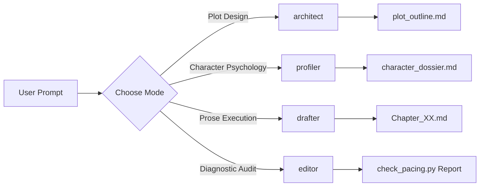

<div align="center">
  
  <h1>Novel Writing Craft Engine</h1>
  <p><b>The Universal Fiction Architecture, Cinematic Storytelling & Narrative Intelligence Engine for ANY AI</b></p>
  <p><i>Works natively on Google Gemini, ChatGPT, Claude.ai, DeepSeek, Antigravity, Cursor, and Local LLMs</i></p>

  <p>
    <a href="LICENSE"></a>
    <a href="https://github.com/Rangga11268/novel-writing-craft-skill/actions"></a>
    <a href="#-universal-ai-compatibility"></a>
    <a href="#-the-10-deep-craft-modules"></a>
    <a href="#-zero-ai-slop-creed"></a>
  </p>
</div>

---

## 🌟 Why This Exists

Most AI models default to fiction that reads like generic, melodramatic summaries: characters *"feel intensely sad"*, villains *"sneer with malice"*, and chapters conclude with unprompted philosophical morality lessons. 

The **Novel Writing Craft Engine** transforms **ANY AI** into a relentless **Master Story Architect** and **Senior Developmental Editor**. It bridges classic screenwriting, literary masterclasses, cognitive neuroscience, and global fiction tropes into an executable system prompt and skill engine.

| Default AI Generation ❌ | Engine-Crafted Fiction ✅ |
|---|---|
| **Abstract Telling:** *"He was terrified of the dark hallway."* | **Somatic Showing:** *"His sneakers squeaked on wet linoleum. His pulse hammered in his teeth while his thumb pressed the pocketknife’s brass rivets."* |
| **Melodramatic Tags:** *"he hissed", "she sneered"* | **Action Beats & Subtext:** Grounded physical movement; dialogue as tactical combat. |
| **Head-Hopping:** Floating POV that betrays reader intimacy | **Strict POV Lock:** Camera welded behind the protagonist’s retinas. |
| **Moralizing Endings:** *"And that night, he learned that love was..."* | **Zeigarnik Open Loops:** Ending on micro-dilemmas and ticking clocks that force the next page turn. |
| **Flat Protagonists:** Adjective lists (*kind, smart, brave*) | **3D Psychological Triad:** The Wound $\rightarrow$ The Lie $\rightarrow$ The Want vs The Need. |

---

## 🌐 Universal AI Compatibility

You don't need to be a developer or run code agents to use this. You can plug this skill directly into your everyday AI chat platform:

### 1. Google Gemini (Gemini Advanced & Gems)
* **Create a Custom Gem:** Open Gemini $\rightarrow$ click **Gem Manager** $\rightarrow$ **New Gem**.
* **Name:** `Novel Craft Master`
* **Instructions:** Copy and paste the contents of [`SKILL.md`](SKILL.md).
* **Knowledge Files:** Upload the markdown files from the `references/` and `templates/` folders as reference documents.
* *Result:* Gemini will now plot, critique, and draft fiction at an elite developmental editor standard.

### 2. OpenAI ChatGPT (Custom GPTs & Custom Instructions)
* **Custom GPT:** Go to **Explore GPTs** $\rightarrow$ **Create**.
* In **Instructions**, paste the text of [`SKILL.md`](SKILL.md).
* In **Knowledge**, drag and drop the `references/` folder.
* *Or for standard ChatGPT:* Paste [`SKILL.md`](SKILL.md) into your **Custom Instructions** (How would you like ChatGPT to respond?).

### 3. Anthropic Claude (Claude.ai Projects)
* Create a **Project** in Claude.ai.
* Set the Project Instructions to [`SKILL.md`](SKILL.md).
* Add all files from `references/` into the **Project Knowledge**. Claude’s 200k context window will seamlessly ingest the entire craft compendium.

### 4. DeepSeek, Copilot, Ollama & Local LLMs (Open-WebUI / LM Studio)
* Set [`SKILL.md`](SKILL.md) as the **System Prompt**.
* For RAG systems, ingest the `references/` directory as your fiction craft knowledge base.

### 5. Autonomous Coding Agents (Antigravity, Claude Code, Cursor)
* **Google Antigravity:** Clone to `~/.gemini/config/skills/novel-writing-craft`.
* **Claude Code:** Clone to `.claude/skills/novel-writing-craft`.
* **Cursor / Windsurf:** Add to `.cursorrules` or `.cursor/rules/novel-writing-craft.mdc`.

---

## 🏛️ Architecture Overview

The repository is built around **Progressive Disclosure**, keeping the primary AI instruction (`SKILL.md`) razor-sharp while providing 10 specialized domain modules on demand:

```
novel-writing-craft-skill/
├── assets/
│   ├── logo.svg                        # Master vector brand mark
│   └── logo.png                        # Rendered 512px high-res asset
├── .github/workflows/
│   └── validate-skill.yml              # Automated CI/CD diagnostic tester
├── references/                         # The 10 In-Depth Craft Modules
│   ├── 01_narrative_architectures.md   # 3-Act, Save the Cat 15 Beats, 7-Point, Story Grid
│   ├── 02_character_psychology_and_arcs.md # The Wound, The Lie Believed, Want vs Need, 4 Arcs
│   ├── 03_scene_and_sequel_mechanics.md    # Goal-Conflict-Disaster & Reaction-Dilemma-Decision
│   ├── 04_visceral_prose_and_sensory.md    # Somatic responses, 5-Sense calibration, Anti-Telling
│   ├── 05_dialogue_subtext_and_combat.md   # Verbal combat, Iceberg Theory, Linguistic Fingerprints
│   ├── 06_danmei_and_romance_tropes.md     # Huan Gong (换攻), Crematorium (火葬场), Awakening
│   ├── 07_cinematic_storytelling_and_screenwriting.md # Truby 22 Steps, Harmon Circle, Hitchcock Suspense, Murch Rule of Six, Pixar
│   ├── 08_neuroscience_of_storytelling_and_suspense.md # Narrative Transportation, Curiosity Gap, Zeigarnik Effect
│   ├── 09_worldbuilding_and_magic_systems.md # Sanderson 3 Laws, Promise-Progress-Payoff, Hemingway Iceberg
│   └── 10_literary_mastery_and_prose_stylistics.md # Palahniuk Submerged "I", King Adverbs, Saunders Gas Station
├── templates/                          # Production-Ready Plotting Cards
│   ├── character_dossier_template.md   # 3D character psychological spec
│   ├── chapter_outline_template.md     # Scene & Sequel chapter blueprint
│   ├── scene_beat_sheet_template.md    # 5-beat micro-scene rhythm
│   └── book_proposal_pitch_template.md # Logline, comps & premise pitch
├── scripts/
│   └── check_pacing.py                 # Automated CLI for word counts, dialogue ratios & slop detection
├── SKILL.md                            # Universal AI Entrypoint
├── CONTRIBUTING.md                     # Community contribution guidelines
├── LICENSE                             # MIT Open Source
└── README.md
```

---

## 🎯 Operating Modes

When chatting with your AI (Gemini, ChatGPT, Claude, etc.), specify an operating mode:



* **`architect`:** *"Acting in architect mode, outline Act II using Save the Cat beats."*
* **`profiler`:** *"Acting in profiler mode, develop the antagonist's Wound, Lie, and Voice."*
* **`drafter`:** *"Acting in drafter mode, write Scene 1 with Palahniuk sensory rules."*
* **`editor`:** *"Acting in editor mode, audit Chapter 3 for pacing, thought verbs, and micro-hooks."*

---

## 📚 The 10 Deep Craft Modules

1. **[01. Narrative Architectures](references/01_narrative_architectures.md):** Classic Three-Act (Syd Field/Weiland), Save the Cat! 15 Beats (Blake Snyder), Dan Wells 7-Point, and Shawn Coyne’s Story Grid 5 Commandments.
2. **[02. 3D Character Psychology](references/02_character_psychology_and_arcs.md):** The core triad (Wound $\rightarrow$ Lie $\rightarrow$ Want vs Need), Positive Change Arcs, Flat Arcs, Disillusionment Arcs, and Corruption/Tragedy Arcs.
3. **[03. Scene & Sequel Mechanics](references/03_scene_and_sequel_mechanics.md):** The rhythmic engine of fiction: Goal $\rightarrow$ Conflict $\rightarrow$ Disaster (No / Yes, BUT / No, AND FURTHERMORE) alternating with Reaction $\rightarrow$ Dilemma $\rightarrow$ Decision.
4. **[04. Visceral Prose & Sensory Execution](references/04_visceral_prose_and_sensory.md):** Somatic autonomic responses (involuntary biology), behavioral tells, objective correlatives, and 5-sense calibration.
5. **[05. Dialogue Subtext & Verbal Combat](references/05_dialogue_subtext_and_combat.md):** Dialogue as action verbs, Hemingway’s Iceberg Theory (the unsaid), and eliminating theatrical tags in favor of action beats.
6. **[06. Danmei & Romance Tropes](references/06_danmei_and_romance_tropes.md):** Deep mechanics of *Huàn Gōng* (换攻 - ML Replacement), *Failed Crematorium* (火葬场), *Heart-Death* (心死), and person-specific *Straight-to-Awakened* dynamics.
7. **[07. Cinematic Storytelling & Screenwriting](references/07_cinematic_storytelling_and_screenwriting.md):** John Truby’s 22 Building Blocks, Dan Harmon’s 8-step Story Circle, Alfred Hitchcock on Suspense vs. Surprise, Walter Murch’s Rule of Six, and Pixar’s 22 Rules.
8. **[08. Cognitive Neuroscience of Suspense](references/08_neuroscience_of_storytelling_and_suspense.md):** Narrative Transportation Theory (Green & Brock), Loewenstein’s Curiosity Gap, Dopamine anticipation curves, and weaponizing Zeigarnik open loops.
9. **[09. Worldbuilding & Magic Systems](references/09_worldbuilding_and_magic_systems.md):** Brandon Sanderson’s Three Laws of Magic/Systems, Promise-Progress-Payoff, and Hemingway's 90% submerged Iceberg worldbuilding.
10. **[10. Literary Mastery & Voice Stylistics](references/10_literary_mastery_and_prose_stylistics.md):** Chuck Palahniuk’s ban on Thought Verbs, Stephen King’s adverb elimination, George Saunders’ Gas Station sentence momentum, and Ursula K. Le Guin’s cadence.

---

## 🛠️ Built-in Diagnostics CLI

The repository includes a Python CLI to analyze chapter drafts:

```bash
python scripts/check_pacing.py path/to/Chapter_01.md
```

**Diagnostic Output:**
```
==================================================
 📖 NOVEL CHAPTER DIAGNOSTIC REPORT
==================================================
File              : Chapter_01.md
Total Words       : 3,420
Dialogue Words    : 1,120 (32.7%)
Pacing Assessment : ✅ Balanced narrative-to-dialogue ratio.

🔍 Checking for Banned AI-Slop & Abstract Telling Patterns:
  ✅ Clean! No banned AI-slop patterns detected.
==================================================
```

---

## 🤝 Contributing

Contributions from authors, dramaturgs, and AI engineers across any language or genre are warmly welcomed! Please read [`CONTRIBUTING.md`](CONTRIBUTING.md) for pull request guidelines.

---

## 📄 License

Distributed under the **MIT License**. Free for personal, commercial, and collaborative creative writing projects.
