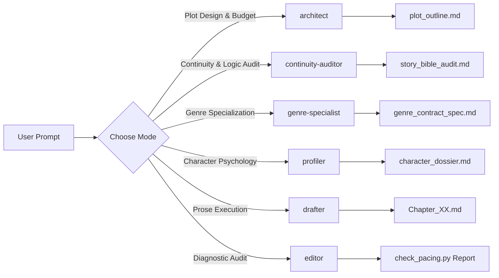

<div align="center">
  
  <h1>Novel Writing Craft Engine</h1>
  <p><b>The Universal Fiction Architecture, Cinematic Storytelling & Narrative Intelligence Engine for ANY AI</b></p>
  <p><i>Works natively on Google Gemini, ChatGPT, Claude.ai, DeepSeek, Antigravity, Cursor, and Local LLMs</i></p>

  <p>
    <a href="LICENSE"></a>
    <a href="https://github.com/Rangga11268/novel-writing-craft-skill/actions"></a>
    <a href="#-universal-ai-compatibility"></a>
    <a href="#-the-16-deep-craft-modules"></a>
    <a href="#-narrative-logic--plot-hole-prevention"></a>
    <a href="#-genre-playbooks-top-3-categories"></a>
    <a href="#-zero-ai-slop-creed"></a>
  </p>
</div>

---

## 🌟 Why This Exists

Most AI models default to fiction that reads like generic, melodramatic summaries: characters *"feel intensely sad"*, dialog sounds like translated office textbooks (*"ini tidak membuat akal sehat"*, *"dia menemukan dirinya"*), and genres lack their sacred audience expectations. 

The **Novel Writing Craft Engine** transforms **ANY AI** into a relentless **Master Story Architect**, **Genre Specialist**, and **Senior Developmental Editor**. It bridges classic screenwriting, literary masterclasses, natural sociolinguistic dialogue, quantitative reader telemetry (Kindle, Wattpad, Qidian), cognitive neuroscience, and specialized genre playbooks into an executable system prompt and skill engine.

| Default AI Generation ❌ | Engine-Crafted Fiction ✅ |
|---|---|
| **Genre Amnesia:** Romance ends in unearned breakups; Mysteries hide clues until the last page; Fantasy cheats its own magic rules. | **Sacred Genre Contracts:** HEA guarantee for Romance; Fair-Play Knox Decalogue for Mystery; Quantified dopamine loops for Progression Fantasy. |
| **Awkward AI Translationese:** *"Ini sama sekali tidak membuat akal sehat, dan dia menemukan dirinya berdiri kaku."* | **Authentic Natural Voice:** *"Gak masuk akal sama sekali. Tahu-tahu dia udah mematung di tengah lorong."* |
| **Robotic Dialog:** Stiff, textbook sentences without particles or subtext. | **Living Dialogue & Sociolects:** Urban youth slang (*lu-gue, sih, kan, deh*), academic wit, or working-class survival speech. |
| **Arbitrary Chapter Length:** Chapters vary wildly (500 words to 6,000 words) with no pacing rhythm. | **Calibrated Pacing Window:** Strict 2,000–3,500 word sweet spot (~10–14 min reading window) avoiding mobile cognitive fatigue. |
| **Abstract Telling:** *"He was terrified of the dark hallway."* | **Somatic Showing:** *"His sneakers squeaked on wet linoleum. His pulse hammered in his teeth while his thumb pressed the brass rivets."* |
| **Melodramatic Tags:** *"he hissed", "she sneered"* | **Action Beats & Subtext:** Grounded physical movement; dialogue as tactical combat. |
| **Head-Hopping:** Floating POV that betrays reader intimacy. | **Strict POV Lock:** Camera welded behind the protagonist’s retinas. |
| **Moralizing Endings:** *"And that night, he learned that love was..."* | **Zeigarnik Open Loops:** Ending on micro-dilemmas and ticking clocks that force the next page turn. |
| **Flat Protagonists:** Adjective lists (*kind, smart, brave*). | **3D Psychological Triad:** The Wound $\rightarrow$ The Lie $\rightarrow$ The Want vs The Need. |

---

## 🎭 Genre Playbooks (The Top 3 Global Categories)

Dedicated structural playbooks covering core promises, bestselling tropes, obligatory scenes, and fatal pitfalls:

### 1. [Romance & BL / Danmei](references/13_genre_playbook_romance_and_bl.md)
* **Emotional Contract:** Connection vs. Isolation. **Non-negotiable HEA/HFN**.
* **Sub-genres & Tropes:** Enemies-to-lovers, Forced Proximity (*Only One Bed*, *Who did this to you?*), Omegaverse (ABO biological agency), and Danmei Crematorium (*Zhuī Qī Huǒ Zàng Chǎng* 追妻火葬场 - groveling, heart-death *Xīn Sǐ*, and *Huàn Gōng* replacement).
* **Obligatory Scenes:** Context Boundary $\rightarrow$ Volatile Collision $\rightarrow$ Forced Enclosure $\rightarrow$ First Crack/Kiss $\rightarrow$ Proof of Sacrifice $\rightarrow$ All-Hope-Is-Lost Breakup $\rightarrow$ Crucible of Penance $\rightarrow$ Recommitment (HEA).

### 2. [Thriller & Psychological Mystery](references/14_genre_playbook_thriller_and_mystery.md)
* **Emotional Contract:** Fear, Dread, Paranoia, and the Cognitive Catharsis of Truth.
* **Sub-genres & Tropes:** Whodunit, Locked-Room, Domestic Suspense (gaslighting spouse), Epistemic Vertigo (Unreliable Narrator), and Mirror Antagonists (Cat-and-Mouse).
* **Knox's Decalogue (Fair Play):** All clues must be shared openly with the reader before the climax. No secret poisons, no late-introduced killers.
* **Obligatory Scenes:** Inciting Mastermind Crime $\rightarrow$ Speech in Praise of Villain $\rightarrow$ Investigator Makes It Personal $\rightarrow$ Red Herring Trap $\rightarrow$ Ticking Clock $\rightarrow$ Hero at Mercy of Villain $\rightarrow$ Weapon of Wit Reversal $\rightarrow$ Final Twist.

### 3. [Fantasy & Progression / Isekai / LitRPG](references/15_genre_playbook_fantasy_and_progression.md)
* **Emotional Contract:** Impotence to Omnipotence, Helplessness to Cosmic Mastery.
* **Sub-genres & Tropes:** Regression (Reversal of Regret), "Trash" Class with Broken Synergies, System Apocalypses, Status Windows, and the Catharsis of Retribution (*Face-Slapping* / 打脸).
* **Obligatory Scenes:** Genesis / Regression $\rightarrow$ Baseline Underdog Stigma $\rightarrow$ Secret Synergy Discovered $\rightarrow$ First Solo Crucible $\rightarrow$ Public Arena Spectacle $\rightarrow$ Conceptual Bottleneck Wall $\rightarrow$ Cataclysmic Boss Raid $\rightarrow$ Apotheosis Breakthrough.

---

## 🛡️ Narrative Logic & Plot Hole Prevention

Unchecked generative models suffer from **narrative amnesia**: characters suddenly know things they never witnessed (*epistemic leakage*), dead characters reappear, magical or technological limits evaporate during climaxes (*convenient nerfing / deus ex machina*), and conflicts drag on purely because two adults refuse a 10-second phone call (*The Idiot Plot*).

Module 16 and Template 6 equip the engine with an unyielding developmental auditing system:

```
┌────────────────────────────────────────────────────────────────────────┐
│               THE 4-GATES LOGIC AUDIT & CAUSALITY ENGINE              │
├───────────────────┬────────────────────────────────────────────────────┤
│ 1. Causality Link │ Replace "AND THEN" with "THEREFORE / BUT" causality│
│ 2. 4-Gates Test   │ Why don't they just call police / use magic / run? │
│ 3. K-State Matrix │ Strict character knowledge tracking (No omniscience│
│ 4. Chekhov Ledger │ Every gun placed must fire; no unearned payoffs    │
└───────────────────┴────────────────────────────────────────────────────┘
```

* **7 Plot Hole Taxonomies Audited:**
  1. **Causal Breaks:** Events occurring without prerequisite causes.
  2. **Character & Motivational Ruptures:** Inexplicable personality or skill shifts to force a plot beat.
  3. **Temporal Paradoxes & Spatial Warping:** Instantaneous travel or inconsistent calendar timelines.
  4. **The Idiot Plot & Contrived Silence:** Forcing artificial misunderstanding where rational people would clarify in 10 seconds.
  5. **Epistemic Telepathy:** Character $B$ acting upon private info known only to Character $A$ and reader.
  6. **Magic / Tech Rule Inconsistency:** Violating established hard limits when the climax demands a spectacle.
  7. **Unfired Guns & Orphaned Setups:** Clues or foreshadowed items introduced with fanfare that disappear without payoff.

* **Master Continuity Ledger:** The included [`story_bible_and_continuity_ledger.md`](templates/story_bible_and_continuity_ledger.md) tracks Master Timelines, Spatial Constraints, the Character Epistemic Matrix (who knows what, when, and from whom), System Hard Limits, and Inventory tracking.

---

## 🌐 Universal AI Compatibility

You don't need to be a developer or run code agents to use this. You can plug this skill directly into your everyday AI chat platform:

### 1. Google Gemini (Gemini Advanced & Gems)
* **Create a Custom Gem:** Open Gemini $\rightarrow$ click **Gem Manager** $\rightarrow$ **New Gem**.
* **Name:** `Novel Craft Master`
* **Instructions:** Copy and paste the contents of [`SKILL.md`](SKILL.md).
* **Knowledge Files:** Upload the markdown files from the `references/` and `templates/` folders as reference documents.
* *Result:* Gemini will now plot, critique, budget words, enforce natural dialogue slang, and draft fiction at an elite developmental editor standard.

### 2. OpenAI ChatGPT (Custom GPTs & Custom Instructions)
* **Custom GPT:** Go to **Explore GPTs** $\rightarrow$ **Create**.
* In **Instructions**, paste the text of [`SKILL.md`](SKILL.md).
* In **Knowledge**, drag and drop the `references/` folder.
* *Or for standard ChatGPT:* Paste [`SKILL.md`](SKILL.md) into your **Custom Instructions** (How would you like ChatGPT to respond?).

### 3. Anthropic Claude (Claude.ai Projects)
* Create a **Project** in Claude.ai.
* Set the Project Instructions to [`SKILL.md`](SKILL.md).
* Add all files from `references/` into the **Project Knowledge**. Claude’s 200k context window will seamlessly ingest the entire craft compendium.

### 4. DeepSeek, Copilot, Ollama & Local LLMs (Open-WebUI / LM Studio)
* Set [`SKILL.md`](SKILL.md) as the **System Prompt**.
* For RAG systems, ingest the `references/` directory as your fiction craft knowledge base.

### 5. Autonomous Coding Agents (Antigravity, Claude Code, Cursor)
* **Google Antigravity:** Clone to `~/.gemini/config/skills/novel-writing-craft`.
* **Claude Code:** Clone to `.claude/skills/novel-writing-craft`.
* **Cursor / Windsurf:** Add to `.cursorrules` or `.cursor/rules/novel-writing-craft.mdc`.

---

## 🏛️ Architecture Overview

Built on **Progressive Disclosure**, keeping the primary AI instruction (`SKILL.md`) razor-sharp while providing 16 specialized domain modules on demand:

```
novel-writing-craft-skill/
├── assets/
│   ├── logo.svg                        # Master vector brand mark
│   └── logo.png                        # Rendered 512px high-res asset
├── .github/workflows/
│   └── validate-skill.yml              # Automated CI/CD diagnostic tester
├── references/                         # The 16 In-Depth Craft Modules
│   ├── 01_narrative_architectures.md   # 3-Act, Save the Cat 15 Beats, 7-Point, Story Grid
│   ├── 02_character_psychology_and_arcs.md # The Wound, The Lie Believed, Want vs Need, 4 Arcs
│   ├── 03_scene_and_sequel_mechanics.md    # Goal-Conflict-Disaster & Reaction-Dilemma-Decision
│   ├── 04_visceral_prose_and_sensory.md    # Somatic responses, 5-Sense calibration, Anti-Telling
│   ├── 05_dialogue_subtext_and_combat.md   # Verbal combat, Iceberg Theory, Linguistic Fingerprints
│   ├── 06_danmei_and_romance_tropes.md     # Huan Gong (换攻), Crematorium (火葬场), Awakening
│   ├── 07_cinematic_storytelling_and_screenwriting.md # Truby 22 Steps, Harmon Circle, Hitchcock Suspense, Murch Rule of Six, Pixar
│   ├── 08_neuroscience_of_storytelling_and_suspense.md # Narrative Transportation, Curiosity Gap, Zeigarnik Effect
│   ├── 09_worldbuilding_and_magic_systems.md # Sanderson 3 Laws, Promise-Progress-Payoff, Hemingway Iceberg
│   ├── 10_literary_mastery_and_prose_stylistics.md # Palahniuk Submerged "I", King Adverbs, Saunders Gas Station
│   ├── 11_quantitative_word_count_and_pacing_metrics.md # Word count by genre, act budgeting, reading speed & telemetry
│   ├── 12_indonesian_stylistics_and_dialogue_slang.md # Literary narrative vs colloquial lu-gue, particles & anti-translationese
│   ├── 13_genre_playbook_romance_and_bl.md # Romance & BL/Danmei Playbook (HEA, Crematorium, ABO, 8 Scenes)
│   ├── 14_genre_playbook_thriller_and_mystery.md # Thriller & Mystery Playbook (Fair Play, Locked Room, Cat & Mouse)
│   ├── 15_genre_playbook_fantasy_and_progression.md # Fantasy & Progression/Isekai (Quantified Growth, Face-Slapping)
│   └── 16_plothole_prevention_and_logic_auditing.md # [NEW] Plot Hole Taxonomies, Causality Auditing & 4-Gates Test
├── templates/                          # Production-Ready Plotting Cards & Ledgers
│   ├── character_dossier_template.md   # 3D character psychological spec
│   ├── chapter_outline_template.md     # Scene & Sequel chapter blueprint
│   ├── scene_beat_sheet_template.md    # 5-beat micro-scene rhythm
│   ├── word_count_and_act_budget_calculator.md # Mathematical act & pacing budget worksheet
│   ├── book_proposal_pitch_template.md # Logline, comps & premise pitch
│   └── story_bible_and_continuity_ledger.md # [NEW] Master timeline, spatial, epistemic & Chekhov gun tracker
├── scripts/
│   └── check_pacing.py                 # Telemetry CLI for word counts, reading duration, dialogue ratios & translationese detection
├── SKILL.md                            # Universal AI Entrypoint
├── CONTRIBUTING.md                     # Community contribution guidelines
├── LICENSE                             # MIT Open Source
└── README.md
```

---

## 🎯 Operating Modes



---

## 🛠️ Built-in Diagnostics CLI

The repository includes a Python CLI to analyze your chapter drafts:

```bash
python scripts/check_pacing.py path/to/Chapter_01.md
```

**Diagnostic Output:**
```
=================================================================
 📖 NOVEL CHAPTER PACING & STYLISTICS DIAGNOSTIC REPORT
=================================================================
File                 : Chapter_01.md
Total Words          : 2,750 words
Reading Time (Print) : ~10.6 minutes (@ 260 WPM)
Reading Time (Mobile): ~12.5 minutes (@ 220 WPM)
Dialogue Words       : 880 words (32.0%)

📏 Chapter Length & Cognitive Session Evaluation:
  ✅ Goldilocks Zone (2,000–3,500 words). Optimal immersion and mobile retention window.

⚖️ Dialogue-to-Narrative Balance:
  ✅ Balanced narrative-to-dialogue ratio (15%–65%).

🔍 Checking for Banned AI-Slop & Abstract Telling Patterns:
  ✅ Clean! No banned AI-slop or thought verbs detected.

🌐 Checking for AI-Translationese & Pseudo-Poetic Clichés:
  ✅ Clean! No mechanical translationese detected.
=================================================================
```

---

## 🤝 Contributing

Contributions from authors, dramaturgs, and AI engineers across any language or genre are warmly welcomed! Please read [`CONTRIBUTING.md`](CONTRIBUTING.md) for pull request guidelines.

---

## 📄 License

Distributed under the **MIT License**. Free for personal, commercial, and collaborative creative writing projects.
