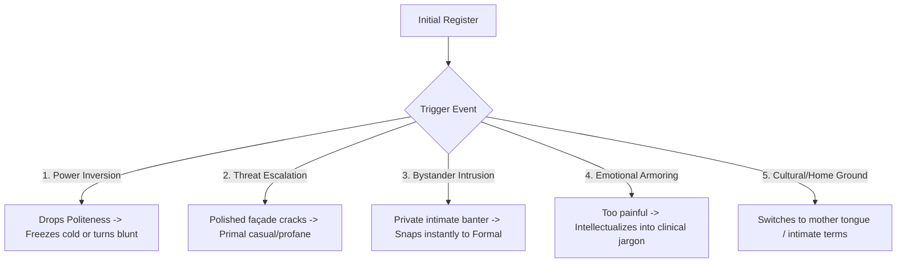

# 17. LINGUISTIC REALISM, CHARACTER IDIOLECTS & WORLD VERISIMILITUDE

> *"Dialogue is not conversation. Dialogue is verbal combat—tactical action taken by a character to achieve a specific desire against resistance."* — **Robert McKee**
>
> *"Realism is not a complete photographic copy of the world, but the art of serious noticing: selecting the idiosyncratic detail whose 'thisness' makes the entire world breathe."* — **James Wood**, *How Fiction Works*

---

## 🧭 Executive Summary

Fiction that feels artificial, cheap, or "AI-generated" almost always suffers from three fatal linguistic flaws:
1. **Mono-Voice Syndrome:** Every character speaks with the same sentence length, vocabulary pool, and formal cadence as the author.
2. **Register Confusion:** Characters speak bookish formal standard language (*bahasa baku teks buku*) in intimate or street settings, or jump between slang and high-register rhetoric without social justification.
3. **Cardboard Settings (Lack of Verisimilitude):** The physical world has no texture, no economic friction, no bureaucratic delays, and no sensory "thisness."

This module establishes the comprehensive architecture for **socio-linguistic register shifting**, **character idiolect profiling (voice fingerprints)**, and **lived-in world verisimilitude**.

---

## 🎭 Part 1: The Speech Register Spectrum (Martin Joos)

Human beings do not have a single speaking voice. We shift across **five distinct sociolinguistic registers** depending on social hierarchy, institutional context, threat level, and emotional intimacy.

```
[ FROZEN / RITUAL ]
        │  (Legal oaths, liturgical texts, sacred institutional vows)
[ FORMAL / ADMINISTRATIVE ]
        │  (Lectures, police interrogations, courtrooms, official hearings)
[ CONSULTATIVE / PROFESSIONAL ]
        │  (Teacher-student, doctor-patient, workplace collaboration)
[ CASUAL / COLLOQUIAL ]
        │  (Peer circles, canteen banter, street slang, social belonging)
[ INTIMATE / VULGAR ]
        ▼  (Lovers in bed, domestic whisper, primal fury, private codes)
```

### The 5 Registers in Contemporary Indonesian & Bilingual Fiction

| Register | Primary Purpose | Syntactic Characteristics | Vocabulary Pool | Dialogue Examples (Indonesian / Bilingual) |
|---|---|---|---|---|
| **1. Frozen / Static** | Hukum, liturgi, upacara | Kalimat pasif preskriptif, formula kaku, klausa mutlak | Arkaisme hukum, bahasa perundangan, teks baku murni | *"Demi keadilan berdasarkan Ketuhanan Yang Maha Esa..."* / *"Barang siapa dengan sengaja..."* |
| **2. Formal / Dinas** | Otoritas publik, sidang, ruang rektorat, aparat | Hipotaksis bertingkat, konjungsi eksplisit, tanpa singkatan (*tidak*, bukan *nggak*) | Kata serapan formal (*rekomendasi, yurisdiksi, konsekuensi, pertimbangan*) | *"Pihak yayasan tidak dapat mentoleransi tindakan indispliner ini tanpa bukti tertulis yang terverifikasi."* |
| **3. Konsultatif / Profesional** | Dosen-mahasiswa, rekan riset, transaksi kerja | Gramatikal teratur dengan pelunak percakapan sopan (*mohon, barangkali*) | Istilah teknis bidang keahlian + kata kerja fungsional | *"Kalau kita ubah alokasi memorinya sekarang, latency-nya bakal naik. Bisa kita diskusikan solusinya besok?"* |
| **4. Kasual / Gaul (Colloquial)** | Tongkrongan, lorong sekolah, sesama sebaya | Parataksis lepas, elipsis (subjek dihilangkan), partikel (*sih, kan, dong, deh, kok*) | Ragam *lu-gue* atau *aku-kamu* santai, idiom tongkrongan, singkatan alami (*udah, emang, beneran*) | *"Gila ya, dari tadi dipanggil Pak Broto pura-pura budeg lu. Cabut yuk, gerah banget di sini."* |
| **5. Intim / Privat** | Bisikan antar pasangan, tangis keluarga, umpatan | Fragmen satu-dua kata, desahan, panggilan privat, kode tak terucap | Panggilan kasih sayang (*Le, Sayang, Cil*), umpatan visceral spontan | *"Sakit... Danu, jangan pergi..."* / *"Brengsek lu."* |

---

## ⚡ Part 2: Code-Switching & Register Shift Triggers

Real people change registers when psychological or social boundaries cross. In fiction, **a shift in register signals an invisible shift in power or emotional armor**.

### The 5 Golden Triggers of Register Shifting



1. **Power Inversion:**
   * When an oppressed character seizes the upper hand, they stop using deferential honorifics (*"Izin, Pak..."*) and adopt cold, clipped monosyllabic statements.
2. **Threat / Stress Escalation:**
   * A suave, manipulative antagonist speaking in smooth consultative banter collapses into vicious street profanity when cornered.
3. **Bystander Intrusion (The Social Wall):**
   * Two characters arguing intimately will instantly snap into stiff professional consultative speech the second an outsider steps into the elevator or classroom.
4. **Emotional Armoring (Intellectualization):**
   * When grief, shame, or romance becomes unbearable, a traumatized character retreats into clinical or technical jargon to avoid feeling emotion directly.
5. **Mother Tongue / Domestic Regression:**
   * When injured, feverish, or grieving, characters shed adopted metropolitan slang and revert to childhood dialects or familial mother tongues (*Jawa, Sunda, Minang, dll.*).

---

## 🧬 Part 3: The 6-Dimensional Character Idiolect Profile (Voice Fingerprint)

To pass **The Tagless Blind Test** (identifying who is speaking with zero dialogue tags or names), every primary character must be profiled across six linguistic dimensions:

```
┌────────────────────────────────────────────────────────────────────────┐
│                   CHARACTER IDIOLECT RADAR PROFILE                     │
├──────────────────────────┬─────────────────────────────────────────────┤
│ 1. Syntactic Architecture│ Mean Length of Utterance (MLU), Fragments   │
│ 2. Sensory/Lexical Bias  │ Mechanical, visceral, abstract, tactile     │
│ 3. Rhythmic Cadence      │ Percussive staccato vs. Flowing legato      │
│ 4. Discourse Markers     │ "Jujur", "secara teknis", "ya kali", "kan"  │
│ 5. Tactical Subtext Armor│ Deflection, silence, counter-attack, irony  │
│ 6. Code-Switch Boundary  │ When do they change language or tone?       │
└──────────────────────────┴─────────────────────────────────────────────┘
```

### Detailed Breakdown:

1. **Syntactic Architecture & MLU (Mean Length of Utterance):**
   * *High MLU (15–30 words):* Articulate, intellectual, scheming, or evasive characters who use nested clauses and conditional statements.
   * *Low MLU (2–6 words):* Pragmatic, traumatized, hyper-competent, or socially defensive characters who speak in blunt declarations and ellipses.
2. **Sensory & Lexical Bias:**
   * A programmer thinks and speaks in logic states, binary choices, inputs, outputs, and latency.
   * A street-smart survivor thinks and speaks in spatial escape routes, cash values, eye contact, and physical posture.
   * An arrogant aristocrat speaks in lineage, connections, entitlement, and dismissive diminutives.
3. **Rhythmic Cadence (Musicality):**
   * *Staccato:* Short, sharp, rhythmic beats. No fluff. Em-dashes for interrupted thoughts.
   * *Legato:* Smooth, melodic, reassuring, gradual build-up with balanced clauses.
4. **Discourse Markers & Verbal Tics:**
   * Pick **one to two subtle verbal habits** per character. Never overdo it. Examples:
     - The appeaser: *"Iya kan? Maksudnya..."*
     - The precise intellect: *"Secara objektif...", "Tergantung metriknya."*
     - The dismissive bully: *"Santai aja kali, lebay amat."*
5. **Tactical Subtext Armor (Robert McKee's Action-Verbs):**
   * What is the character *doing* with their words?
   * *Danu:* Placating, neutralizing, withholding, stonewalling.
   * *Satria:* Provoking, testing loyalty, patronizing, cornering.
   * *Adrian:* Disarming, inviting, validating, clarifying.
6. **Code-Switching Threshold:**
   * Under what exact trigger does their mask slip?

---

## 🏙️ Part 4: Deep World Verisimilitude & "Serious Noticing"

Readers do not believe in a story because of grandiose worldbuilding paragraphs. Readers believe because of **hyper-specific physical friction and sensory "thisness"** (*James Wood's Haecceity*).

### 1. The Socio-Economic Arithmetic of Scarcity
* Poor or struggling characters do not just feel "poor"—they navigate the world through constant mathematical micro-calculations:
  * Calculating whether taking a JakLingko microbus leaves enough for two generic paracetamol tablets at the warung.
  * Re-soldering a fraying charging cable with electrical tape for the fifth time because a replacement costs three days of lunch money.
  * Drinking plain warm water from an unbranded refill tumbler instead of buying bottled mineral water at the school canteen.
* Wealthy or privileged characters possess a distinct **sensory blindness**:
  * Leaving half-eaten imported meals on plates without checking the bill.
  * Tossing expensive parking cards or crumpled receipts onto car dashboards without looking.
  * Assuming everyone has high-speed private Wi-Fi and updated hardware.

### 2. Institutional Texture & Bureaucratic Friction
A believable world is not frictionless. Institutions must exhibit realistic operational flaws:
* **School / University:** Sluggish biometric attendance scanners, humid locker rooms smelling of damp laundry and floor cleaner, broken ACs rattling against whiteboard rails, slow administrative signatures.
* **Technology / Coding Realism:**
  * Avoid Hollywood hacking clichés (*"I'm in!"* with green matrix fonts).
  * Feature real developer textures: tiling window managers (i3/Hyprland), terminal buffers in NeoVim, kernel panic logs, compilation segmentation faults (`SIGSEGV`), the distinct tactile click of mechanical switches or worn rubber-dome keyboards.
* **Hospitals / Illness:**
  * The sour smell of antiseptic floor wax mixed with cooling generic porridge in plastic styrofoam.
  * The sound of BPJS queue number speakers crackling over hospital benches at 6:30 AM.

### 3. Slang Half-Life vs. Evergreen Colloquialism
* **The Slang Half-Life Rule:**
  * Avoid hyper-transient internet meme words that spoil within 12 months.
  * Rely on **evergreen colloquial syntax**: Indonesian natural particles (*kok, sih, dong, deh, kan*), rhythmic contractions (*udah, emang, beneran, cabut, males*), and distinct phrasing cadences rather than disposable viral terms.

---

## 📋 Part 5: The 10-Point Dialogue & Realism Audit Checklist

Use this checklist before finalizing any dialogue-heavy chapter:

- [ ] **1. Tagless Blind Test:** Can you obscure all dialogue tags and tell who is speaking purely from voice rhythm and vocabulary?
- [ ] **2. Action-Verb Audit:** Does every spoken line carry an active tactical subtext (provoking, disarming, evasive, comforting) rather than naked exposition?
- [ ] **3. Subtext Masking:** Are emotional vulnerabilities shielded behind irony, technical terms, silence, or humor rather than raw melodrama?
- [ ] **4. Register Congruence:** Does the dialogue match the setting, social hierarchy, and the presence of bystanders?
- [ ] **5. Code-Switching Justification:** If a character shifts from casual to formal (or vice versa), is the psychological or situational trigger explicit?
- [ ] **6. Banned Translationese Purge:** Zero mechanical English-calque idioms (*"ini membuat akal sehat"*, *"menemukan dirinya"*, *"mengambil nafas panjang"*).
- [ ] **7. Particle Naturalness:** Are Indonesian discourse particles (*sih, deh, kok, kan, dong*) placed with authentic native cadence rather than robotic rhythm?
- [ ] **8. Socio-Economic Consistency:** Do the physical objects, transit habits, and monetary choices of characters align strictly with their material reality?
- [ ] **9. Procedural Friction:** Does the institutional setting push back with realistic delays, worn physical textures, or bureaucratic red tape?
- [ ] **10. Two "Thisness" Anchors:** Does the scene contain at least two vivid, idiosyncratic sensory details that ground the fictional space in tactile truth?
