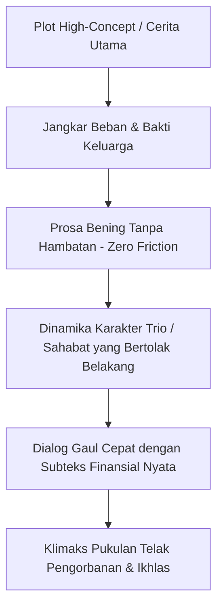

# 21. THE NUSANTARA BESTSELLER CRAFT: TERE LIYE & J.S. KHAIREN
### *Synthesizing Narrative Velocity, Zero-Friction Prose, Gritty Youth Realism & Filial Gut-Punches*

> *"Novel yang dibaca tuntas dalam satu malam tidak lahir dari kalimat-kalimat yang rumit. Ia lahir dari cerita yang bergerak cepat, karakter yang terasa seperti sahabat sendiri, dan luka batin yang mencerminkan realitas hidup pembacanya."*

---

## 🧭 Executive Summary

Dua ikon penulis kontemporer paling berpengaruh di Indonesia—**Tere Liye** (penulis serial *Bumi/Klan*, *Pulang/Pergi*, *Negeri Para Bedebah*, *Hujan*, *Rembulan Tenggelam di Wajahmu*) dan **J.S. Khairen** (penulis serial *Kami (Bukan) Sarjana Kertas*, *Melangkah*, *Dompet Ayah Sepatu Ibu*, *Bungkam Suara*)—memegang kunci psikografis pembaca regional Asia Tenggara.

Meskipun memiliki latar belakang genre yang berbeda (Tere Liye menguasai *high-concept speculative fiction* dan *financial thriller*; JS Khairen menguasai *gritty youth satire* dan *nusantara high-concept*), keduanya berbagi formula penceritaan yang membuat buku-buku mereka **"unputdownable"** (mustahil diletakkan sebelum tamat).

Modul ini membedah cetak biru kepenulisan mereka ke dalam prinsip-prinsip yang dapat dieksekusi oleh mesin fiksi kita.

---

## 🌟 PART 1: TERE LIYE'S NARRATIVE ARCHITECTURE

### 1. "Zero-Friction Prose" (Prosa Bening Tanpa Hambatan)
* **Filosofi:** Prosa Tere Liye berfungsi seperti kaca jendela yang jernih—pembaca tidak disibukkan mengagumi kerumitan kalimat penulis, melainkan langsung melihat peristiwa yang sedang terjadi.
* **Ciri Sintaksis:**
  * Struktur Subjek-Predikat-Objek yang lugas dan dominan verba aktif.
  * Menghindari kata sifat yang abstrak dan berbunga-bunga (*purple prose*).
  * Menjelaskan konsep kosmis atau emosional lewat **metafora indrawi sehari-hari**:
    > *"Cinta sejati itu seperti air hujan; ia turun tanpa memilih tanah mana yang basah, membersihkan debu, dan menghidupkan tanah tandus."*
  * Setiap bab baru dibuka dengan **tiga jangkar indrawi konkret** (aroma kopi tubruk panas di cangkir seng, deru angin dingin yang memukul jendela kereta, bau tanah basah sehabis hujan lebat).

### 2. Ticking-Clock Propulsion & Cliffhanger Engineering
* **Formula Kecepatan:** Cerita Tere Liye tidak pernah berhenti di tempat. Setiap bab adalah *micro-arc* yang diakhiri dengan:
  * Pertanyaan besar yang belum terjawab (*Curiosity Gap*).
  * Batas waktu yang menyempit (*Ticking Clock*): Di *Negeri Para Bedebah*, Thomas hanya punya waktu 24 jam untuk menyelamatkan bank dan menghindari pembunuh bayaran; di serial *Bumi*, portal antar-dimensi memiliki waktu kedaluwarsa beberapa menit.
  * Kemunculan rintangan baru yang tak terduga tepat di baris terakhir bab.
* **Eksposisi Sambil Berlari (*Moving Lore*):** Informasi dunia fantasi atau teori keuangan tidak pernah diceramahkan dalam paragraf panjang yang statis. Penjelasan selalu disampaikan **di tengah aksi fisik** (misal: saat melarikan diri di kereta magnetik atau saat merakit kapsul penyelamat).

### 3. Dinamika Trio Seimbang (The Raib-Seli-Ali Archetype)
Formula kelompok tiga serangkai Tere Liye adalah cetak biru sempurna untuk menjaga cerita tetap segar dan menghibur:

```
┌────────────────────────────────────────────────────────────────────────┐
│                   THE TERE LIYE TRIO PSYCHOLOGY                        │
├───────────────────┬────────────────────────────────────────────────────┤
│ 1. The Compass    │ Moral, bijak, peka, memikul takdir (Raib)          │
│ 2. The Dynamo     │ Hangat, setia kawan, peredam konflik (Seli)        │
│ 3. The Contrarian │ Genius, slengean, pembuat onar, inovatif (Ali)     │
└───────────────────┴────────────────────────────────────────────────────┘
```
* **Kunci Interaksi:** *The Compass* memberikan arah moral, *The Dynamo* menjaga kehangatan emosi kelompok, dan *The Contrarian* merusak kebosanan dengan mendobrak aturan dan menciptakan solusi tak terduga.

### 4. Beban Moral Nyata & Filosofi Ikhlas
* Tokoh Tere Liye (seperti Bujang di *Pulang*) memegang janji moral yang berat (misal: tidak pernah minum alkohol atau berkhianat, demi sumpah pada ibunya). Batasan moral inilah yang membuat pembaca jatuh cinta pada karakter yang keras.
* **Filosofi Ikhlas:** Puncak resolusi Tere Liye bukan kemenangan materi yang sombong, melainkan **penerimaan takdir (*ikhlas*) dan ketenangan jiwa**.

### 5. Studi Kasus Utama: Arsitektur Cinta & Sci-Fi dalam *Hujan* (2016)
Berdasarkan telaah mendalam naskah asli *Hujan* (318 halaman):
* **Dual-Timeline & Framing Device (Ruang Terapi Saraf 2042):**
  * Ruangan kubus putih $4 \times 4\text{ m}^2$, bando logam pemindai saraf, dan interogasi klinis oleh Elijah.
  * **Visualisasi Metaforis Benang Memori:**
    * 🔴 **Benang Merah:** Trauma bencana, kehilangan orang tua, kecemburuan, sakitnya penantian tanpa kepastian.
    * 🔵 **Benang Biru:** Sukacita pengorbanan, kepedulian tulus, pemulihan, dan penerimaan takdir.
    * 🟡 **Benang Kuning:** Memori netral/keseharian.
* **Dinamika Lail & Esok (Soke Bahtera) — *Restraint & Acts of Service*:**
  * Cinta sejati dibangun tanpa kata-kata vulgar atau sentuhan fisik picisan. Esok tidak pernah merayu; cintanya hadir lewat **aksi nyata dan benda jangkar**:
    1. *Sepeda Merah:* Menjemput Lail sebelum hujan asam vulkanik turun; membonceng Lail mengitari kota saat gerimis.
    2. *Celemek Motif Bunga:* Hadiah agar Lail dipindah dari tugas kasar mencuci pantat panci ke tugas memasak.
    3. *Topi Biru Rajutan ("The Smart One"):* Kenang-kenangan yang dipakai Esok dari masa sekolah hingga dewasa.
  * **The Deletion Beat (Mengetik lalu Menghapus):** Lail berkali-kali menulis *"Miss you too"* atau *"Aku rindu"*, namun selalu menghapusnya demi menjaga harga diri dan tidak ingin mengganggu riset masa depan Esok.
* **Fungsi Sentral Maryam (The Irreplaceable Foil):**
  * Tanpa Maryam (gadis kribo, cerewet, hobi menggoda), Lail akan mati suri dalam rasa cemburu dan minder terhadap Claudia.
  * Maryam adalah jangkar keberanian Lail: menemani lari 50 km menembus lumpur, dan menjadi pahlawan yang **menelepon Esok 15 menit sebelum kapal berangkat**.
* **Plot Twist & The Acceptance Rule (Penerimaan):**
  * Esok ternyata tidak pernah berniat meninggalkan Lail. Esok mengkloning saraf otaknya ke komputer navigasi kapal agar raganya tetap bisa menemani Lail di bumi. Tiket kedua diberikan ke Claudia murni agar ada yang merawat ibunya yang lumpuh.
  * Di detik terakhir sebelum mesin modifikasi ingatan dijalankan, Lail memilih **memeluk erat dan menerima seluruh rasa sakitnya**. Seluruh benang merah berubah menjadi benang biru. Mesin tidak menghapus satu pun kenangan tentang Esok karena tidak ada lagi kepedihan yang tersisa.
  > *"Bukan melupakan yang jadi masalahnya. Tapi menerima. Barangsiapa yang bisa menerima, maka dia akan bisa melupakan, hidup bahagia. Tapi jika dia tidak bisa menerima, dia tidak akan pernah bisa melupakan."*

---

## ⚡ PART 2: J.S. KHAIREN'S GRITTY REALISM & FILIAL PUNCHES

### 1. Gritty Youth Realism & Satir Sosial yang Menggigit
* **Anti-Menara Gading:** Alih-alih menulis kehidupan kampus elite yang glamor, JS Khairen mengangkat realitas *Kampus UDEL*—kampus swasta pinggiran tempat berkumpulnya mahasiswa buangan yang terancam jadi "pengangguran berijazah".
* **Kritik Sistemik yang Bernyawa:** Membedah keresahan generasi muda Indonesia secara telanjang:
  * Jeratan *Sandwich Generation* (anak muda yang membiayai utang orang tua, sekolah adik, dan sewa kos sendiri).
  * Fenomena lowongan kerja *entry level* gaji UMR tapi menuntut pengalaman 5 tahun.
  * Praktik pinjaman online ilegal, magang tanpa bayaran, dan komersialisasi pendidikan.
* **Humor sebagai Tameng Bertahan Hidup (*Gallows Humor*):** Karakter-karakternya menertawakan kemiskinan mereka sendiri agar tidak gila. Lelucon adalah senjata terakhir melawan keputusasaan ekonomi.

### 2. Dialog Gaul Autentik & Ritme Staccato
* Karakter berbicara menggunakan bahasa percakapan nyata: partikel *lu-gue*, istilah tongkrongan (*bego, kampret, anjir, skripshit*), dan ritme tembakan cepat (*staccato*):
  > *"Lu mau makan gengsi apa makan nasi?"*  
  > *"Gengsi nggak bikin kenyang, San."*  
  > *"Makanya! Banting harga diri lu sekarang, atau besok lu pinjem duit ke pinjol!"*
* Setiap lelucon selalu menyimpan **subteks kecemasan finansial** (menghitung apakah sisa uang Rp15.000 cukup untuk makan Indomie dan beli bensin motor sampai hari Jumat).

### 3. Pukulan Telak Pengorbanan Orang Tua (*The Filial Gut-Punch*)
* **Motif Pengorbanan Bisu (*Dompet Ayah Sepatu Ibu*):**
  * *Dompet Ayah:* Dompet kulit imitasi yang mengelupas, isinya bukan uang melainkan nota pegadaian, karcis parkir kusut, dan foto ijazah anak—uangnya selalu habis untuk SPP.
  * *Sepatu Ibu:* Sol sepatu yang sudah tiga kali dilem Alteco, berjalan kaki bermil-mil di bawah terik matahari demi menghemat ongkos angkot agar anaknya bisa beli buku cetak.
* **Paradoks Bohong Anak Rantau:**
  * Anak di kota makan mie instan kuah air dispenser dan berbohong di telepon: *"Alhamdulillah Mak, makan kenyang terus kok di sini, kerjaan lancar."*
  * Orang tua di kampung makan nasi garam dan berbohong di telepon: *"Bapak sama Ibu sehat, gak usah kirim uang dulu, tabung aja buat masa depanmu."*
  * Adegan ini selalu menghantam pembaca Indonesia hingga menangis karena ini adalah cerminan jutaan keluarga nyata.

---

## 🛠️ PART 3: SINTESIS ATURAN UNTUK NOVEL WRITING ENGINE

Untuk menerapkan kekuatan kedua maestro ini ke dalam karya kita:



### 1. Aturan "Beban & Bakti" (Keluarga sebagai Jangkar Taruhan)
* Setiap kali protagonis berjuang menghadapi musuh besar, musuh sistem, atau tantangan akademis, **selalu hubungkan taruhan tersebut dengan orang yang ia cintai di rumah**:
  * Danu tidak sekadar ingin beasiswa MIT demi prestise pribadi; ia butuh biaya obat amlodipine dan clopidogrel neneknya, serta ingin menebus surat tanah petak kontrakan yang digusur.

### 2. Aturan Prosa Cepat & Anti-Menara Gading
* Kalimat narasi aksi dibatasi **6–15 kata per kalimat**.
* Pangkas perenungan batin yang melingkar-lingkar. Karakter membuktikan isi hatinya melalui **tindakan nyata dan pengorbanan fisik**.

### 3. Aturan Satir Finansial dalam Dialog
* Dialog antar-remaja atau anak muda harus mencerminkan kalkulasi ekonomi riil:
  * *"Lu kira naik KRL gratis? Koin gue tinggal dua biji di kantong."*
  * *"Gak usah sok traktir kalau besok lu makan kuah royco sama nasi anget."*

### 4. Dua Tahap Pukulan Emosional di Titik Balik (The Gut-Punch Climax):
1. **Tahap 1: Terbukanya Pengorbanan Tersembunyi:** Karakter menemukan benda peninggalan orang tua/wali (misal: buku tabungan tua yang disembunyikan di bawah kasur, atau resi pegadaian cincin kawin demi membelikannya laptop bekas).
2. **Tahap 2: Kebangkitan Ikhlas:** Karakter berhenti menangis, menyeka air matanya, menegakkan dagunya, dan melangkah menghadapi dunia dengan ketegaran mutlak.
